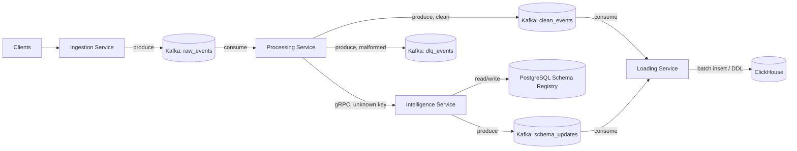
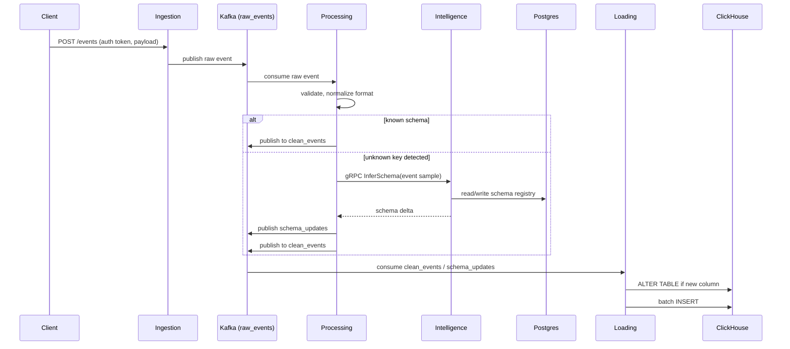
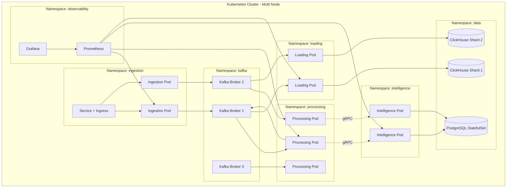
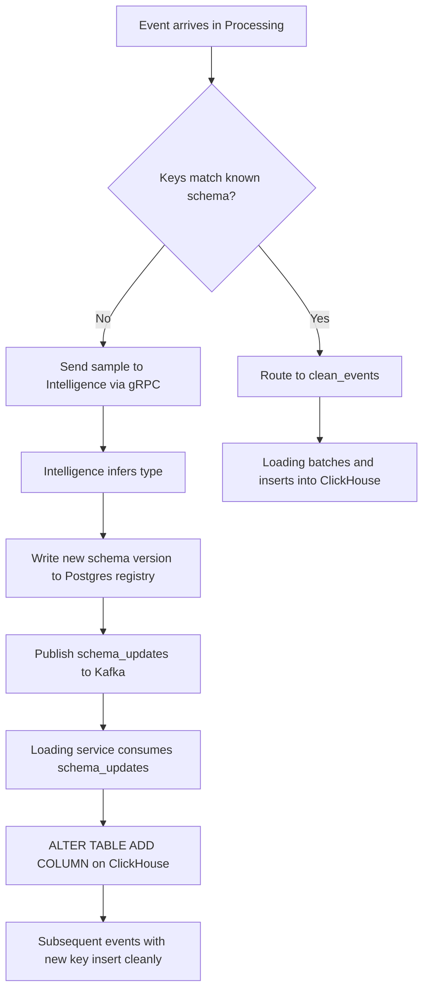

# Clickstream Ingestion Pipeline

A multi-node, microservice-based system for ingesting high-volume clickstream
data from heterogeneous sources, validating and cleaning it, automatically
detecting new event fields, evolving the destination schema, and loading
the data into an analytical store. Deployed as containerized microservices
on Kubernetes.

## Table of Contents

- [Overview](#overview)
- [Architecture](#architecture)
- [Tech Stack](#tech-stack)
- [Data Flow](#data-flow)
- [Kubernetes Topology](#kubernetes-topology)
- [Schema Evolution Flow](#schema-evolution-flow)
- [Scale Targets](#scale-targets)
- [Repository Structure](#repository-structure)
- [Local Development](#local-development)
- [Deployment](#deployment)
- [Roadmap](#roadmap)

## Overview

| Property | Value |
|---|---|
| Design throughput | 1,000,000 requests/sec |
| Demonstrated throughput | Documented separately per load test, see `/docs/load-test.md` |
| Data volume (sample) | 5 GB |
| Orchestration | Kubernetes, multi-node cluster |
| Primary language | Python |
| Messaging | Kafka |
| Inter-service RPC | gRPC |
| Analytical store | ClickHouse |
| Metadata store | PostgreSQL |

## Architecture



## Tech Stack

| Layer | Technology | Purpose |
|---|---|---|
| API framework | FastAPI, Uvicorn/Gunicorn | Async HTTP ingestion layer, auth |
| Messaging | Apache Kafka (Strimzi operator on K8s) | Decoupled, replay-able event backbone |
| Inter-service RPC | gRPC, Protocol Buffers | Low-latency schema-inference calls |
| Metadata store | PostgreSQL | Schema registry, auth, service config |
| Analytical store | ClickHouse | High-volume event storage and query |
| Orchestration | Kubernetes | Multi-node deployment, scaling, self-healing |
| Kafka client | aiokafka / confluent-kafka-python | Producer/consumer implementation |
| DB clients | asyncpg, clickhouse-connect | Async Postgres and ClickHouse access |
| Containerization | Docker | Service packaging |
| Package management (K8s) | Helm | Templated manifests per environment |
| CI/CD | GitHub Actions | Build, test, push image, deploy |
| Observability | Prometheus, Grafana | Metrics, dashboards |
| Logging | structlog, Fluent Bit | Structured logs, cluster-wide aggregation |
| Load testing | Locust or k6 | Throughput and latency validation |
| Autoscaling | Kubernetes HPA | Scale Ingestion/Processing/Loading on load |

## Data Flow



## Kubernetes Topology



Each service namespace ships with a `Deployment`, a `HorizontalPodAutoscaler`
keyed on CPU and Kafka consumer lag, and a `Service` for internal routing.
Kafka runs via the Strimzi operator as a `Kafka` custom resource with a
configurable number of broker pods and partitions per topic. PostgreSQL and
ClickHouse run as `StatefulSet`s with persistent volume claims; ClickHouse
uses the `ReplicatedMergeTree` engine across shards for horizontal scale.

## Schema Evolution Flow



## Scale Targets

| Metric | Design target | Notes |
|---|---|---|
| Ingest rate | 1,000,000 req/sec | Achieved via horizontal pod scaling and Kafka partition count, not a single-node number |
| Kafka partitions | Sized per topic based on target consumer parallelism | Partition count should be greater than or equal to max consumer replicas |
| ClickHouse | Sharded, replicated cluster | Writes batched by Loading service, never row-by-row |
| Postgres | Single primary with read replicas | Low write volume, schema registry only |
| Pod autoscaling | HPA on CPU and Kafka consumer lag | Prevents over-provisioning at idle |

Any throughput number reported for this project should be backed by a load
test (see `/docs/load-test.md`) with cluster size, partition count, and
replica count documented alongside the result.

## Repository Structure

```
.
├── services/
│   ├── ingestion/
│   ├── processing/
│   ├── intelligence/
│   └── loading/
├── proto/
│   └── schema_inference.proto
├── charts/
│   ├── ingestion/
│   ├── processing/
│   ├── intelligence/
│   ├── loading/
│   └── kafka/
├── infra/
│   ├── k8s-manifests/
│   └── terraform/ (optional, for cluster provisioning)
├── docs/
│   ├── architecture.md
│   └── load-test.md
└── README.md
```

## Local Development

Local development uses `kind` or `minikube` to approximate the multi-node
cluster, or Docker Compose for a lighter single-node loop during early
service development.

```bash
# spin up a local multi-node cluster
kind create cluster --config infra/k8s-manifests/kind-multi-node.yaml

# install Kafka via Strimzi
kubectl apply -f infra/k8s-manifests/strimzi-operator.yaml

# deploy all services via Helm
helm install ingestion charts/ingestion
helm install processing charts/processing
helm install intelligence charts/intelligence
helm install loading charts/loading
```

## Deployment

Deployment to a multi-node cluster (cloud-managed or self-hosted) follows
the same Helm charts with environment-specific `values.yaml` overrides for
replica counts, resource requests/limits, and storage class. CI/CD builds
and pushes container images on merge to main, then applies Helm upgrades to
the target cluster.

## Roadmap

| Phase | Focus | Output |
|---|---|---|
| 0 | Local K8s cluster and Kafka via Strimzi | Working multi-node cluster locally |
| 1 | Ingestion service | Deployed, authenticated, publishing to Kafka |
| 2 | Processing service | Validating, normalizing, routing known/unknown keys |
| 3 | Intelligence service | gRPC schema inference, Postgres registry |
| 4 | Loading service | Batched ClickHouse writes, dynamic ALTER TABLE |
| 5 | Autoscaling and observability | HPA tuned, Prometheus/Grafana dashboards live |
| 6 | Load testing | Throughput report with cluster configuration documented |
| 7 | CI/CD and documentation | Automated deploys, complete docs |